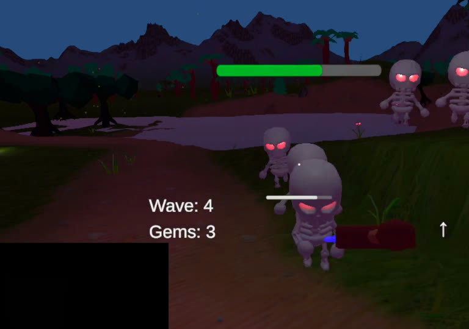
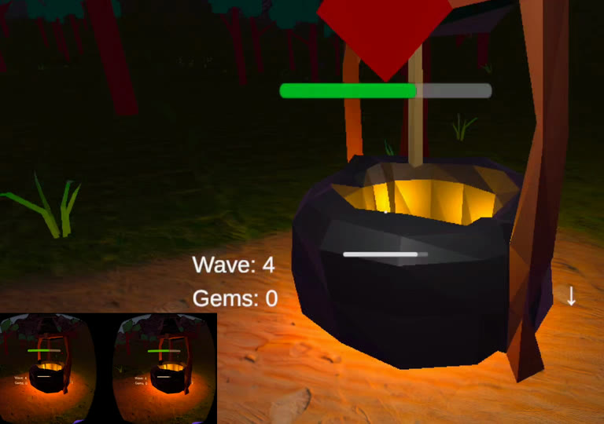
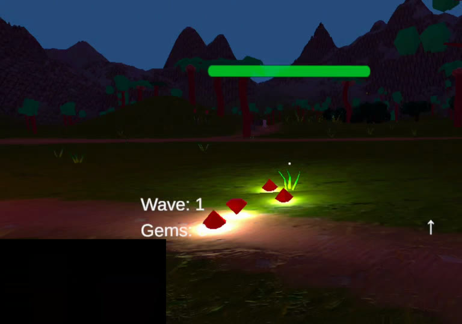

# Skeleton Waves VR

**A wave-survival game you play in virtual reality.** Put on a Meta Quest headset and skeletons run at you from every direction. Hit them with a sword. Each wave is bigger than the last, and the only question is how long you survive.

  
  
  

**[Watch a 5-minute run](docs/media/demo.mp4)** (with sound) — the first five waves, a trip to the wishing well and a sword upgrade.

## What you do

You stand in a forest clearing and fight skeletons with a sword. Skeletons sometimes drop glowing gems when they die. You can carry those gems to a magic wishing well and trade them for a better sword. Then the next wave comes, and it's harder. When a skeleton finally gets you, the game tells you how long you lasted.

That's the whole game. The interesting part is that nothing is scripted wave by wave — the difficulty is worked out by a formula, so it can keep getting harder forever without anyone designing each wave by hand.

## The systems, in plain English

- **Waves.** Each new wave has more skeletons that run faster and hit harder than the one before. The game computes this from a small formula rather than a hand-written list, so there is no "final wave."
- **The skeletons actually look for you.** A skeleton doesn't automatically know where you are. It has to see you. If you hide behind a tree, it loses you and wanders back to where it last saw you.
- **Some waves hunt as a pack.** On certain waves, if one skeleton spots you, all of them come. On other waves they each act alone, so you can't rely on a single trick.
- **The well is a gamble.** The more gems you throw in, the better your chance of a top-tier sword — but it's never guaranteed. A few gems might get lucky; a lot of gems shifts the odds in your favour.
- **Swords break.** Every hit wears your sword down. When it shatters you're unarmed until you grab a new one, so a good sword is precious.

## Controls

| Action | Keyboard / mouse | Gamepad |
|---|---|---|
| Move | `W` `A` `S` `D` | Left stick |
| Look | Mouse | Turn your head |
| Sprint | `Shift` | Click left stick |
| Jump | `Space` | `A` |
| Attack | Left click | Right trigger |
| Pick up / drop sword | `E` | `Y` |
| Loot barrel / use well | `E` | `X` |
| Throw a gem | `Q` | `B` |

> **Note:** the game reads your head movement from the headset, but you move with a gamepad (or keyboard in the editor). It doesn't use the Quest hand controllers yet.

## Running it

You need Unity **6000.3.8f1** (free). Open this folder in Unity Hub, open `Assets/Scenes/SampleScene.unity`, and press Play to try it on your computer with a keyboard and mouse. To play it on an actual Quest, build for Android and sideload it, or build and run straight to the headset with developer mode on.

---

<b>Technical detail</b> — how the systems are implemented, for a developer reader

### Wave scaling (`InfiniteWaveController.cs`)

Each wave is computed from a formula, so the game has no hand-authored wave table and can scale forever:

| Wave | Skeletons | Speed | Damage | Gem drop | Hive mind |
|---|---|---|---|---|---|
| 1 | 1 | 2.8 | 8 | 70% | no |
| 2 | 3 | 3.2 | 10 | 66% | no |
| 3 | 6 | 3.6 | 12 | 62% | no |
| 4 | 11 | 4.0 | 14 | 58% | yes |
| 5 | 18 | 4.4 | 16 | 54% | yes |
| 6 | 25 | 4.8 | 18 | 50% | no |
| 7 | 34 | 5.2 | 20 | 46% | yes |

- **Count:** `start + (wave - 1)^1.65 * 1.7`, rounded. Faster than linear, slower than quadratic.
- **Speed:** +0.4 per wave, capped at 90% of the player's sprint so enemies stay beatable.
- **Damage:** +2 per wave, capped at 40.
- **Gem drops:** fall 4% per wave to a floor of 30%.
- **Hive mind:** on from wave 3 except every third wave.

### Skeleton AI (`EnemyAI.cs`)

- **Perception:** an overlap sphere (range 20) finds the player, then a raycast checks line of sight.
- **Search:** on losing sight it walks to the last known position, slows on arrival, then roams.
- **Hive mind:** a static shared target and a counter of members that currently see the player. If one sees you, every hive-mind skeleton chases you. The counter stays correct as enemies die or lose sight.
- **Attack:** damage plus knockback, applied as an impulse in `PlayerMovement`.
- **Feedback:** an "angry" blendshape driven from `LateUpdate` so animation clips can't overwrite it.

### Wishing well (`WishingWell.cs`)

Sword odds scale with gems thrown in. The middle tier rises linearly from 19% (3 gems) to 55% (20 gems). The top tier rises with the cube of progress, from 1% to 30%. Weights are normalised and rolled once, and the sword is launched with a safe-spawn check.

### Weapons (`Sword.cs`, `WeaponManager.cs`)

| Sword | Damage | Durability loss per hit |
|---|---|---|
| Wood | 10 | 3 |
| Stone | 20 | 2 |
| Diamond | 50 | 1 |

Each sword has 100 durability and a skeleton has 100 health. Each enemy is hit once per swing. A broken sword notifies the weapon manager and leaves the player empty-handed.

### Player and HUD (`PlayerHealth.cs`, `PlayerMovement.cs`)

Health and durability bars, wave and gem counters, and an arrow that points to the nearest skeleton using the headset's heading. Movement is a rigidbody with velocity, ground check, sprint, jump and decaying knockback.

<b>Third-party assets</b>

Included so the project opens and runs as built. Each belongs to its owner.

- **Low Poly Stylized Nature** by Cody Dreams — trees, props, camp, barrel, structures.
- **Stylized Gem Pack** by PolyKebap — gems.
- **Lowpoly Forest Pack** by Onerat Games.
- **Mini Simple Characters Skeleton Demo** — the skeleton and animations.
- **Google Cardboard XR** and **XR Interaction Toolkit** samples, TextMesh Pro.
- **Audio** — music, sword, healing and UI sounds plus game sound effects, used for demonstration.

<b>Known limitations</b>

- **No tracked-controller input.** Looking uses the headset and movement needs a gamepad.
- **Simple pathing.** Skeletons steer directly with a rigidbody and don't path around obstacles.
- **Name-based UI lookup.** The HUD finds elements by object name at startup; renaming breaks the link.
- **No automated tests.** Balance was tuned by playing.

---

Daniel Jackson · <a href="https://github.com/DanielJacksonRSA">GitHub</a> · code in <code>Assets/Scripts</code>: <a href="LICENSE">All rights reserved</a>

